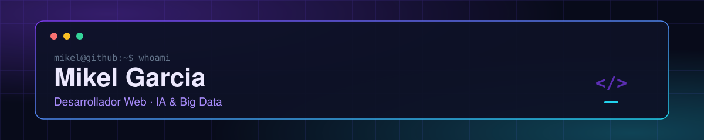

 

---

> **Técnico Superior en Desarrollo de Aplicaciones Web (DAW)**, con formación en la **especialización de Inteligencia Artificial y Big Data**. Me gusta construir proyectos completos, de la lógica a la interfaz: aplicaciones web, APIs con Node.js, plugins de Moodle y análisis de datos con Python.
>
> Me interesa el **desarrollo web**, el **diseño de APIs** y la **automatización**. Busco mi primera oportunidad profesional como desarrollador junior.

<h2 align="center">Stack</h2>

  

**Lenguajes**

**Datos y monitorización**

**Herramientas**

<h2 align="center">Aprendiendo ahora</h2>

- **Desarrollo web:** afianzando JavaScript, TypeScript y el consumo de APIs.
- **Python y datos:** análisis exploratorio, visualización y automatización de tareas.
- **IA aplicada:** integración de agentes y modelos en aplicaciones web y entornos de formación.

<h2 align="center">Proyectos destacados</h2>

<table>
  <tr>
    <td width="50%" valign="top">
      <h3>CHATBOT — interfaz web para un chatbot</h3>
      
Interfaz web que consume la API de un chatbot, desarrollada durante una formación en LKS Next.

      
<code>Angular</code> <code>TypeScript</code>

      

    </td>
    <td width="50%" valign="top">
      <h3>Wordle — juego web full-stack</h3>
      
Recreación del popular juego Wordle, con validación de palabras, interfaz en JavaScript y backend en Node.js.

      
<code>JavaScript</code> <code>Node.js</code>

      

    </td>
  </tr>
  <tr>
    <td width="50%" valign="top">
      <h3>RETO_DATA_ANALYTICS — análisis de datos</h3>
      
Análisis exploratorio y visualización de un dataset de engagement en redes sociales con Python, Pandas y Jupyter Notebook.

      
<code>Python</code> <code>Pandas</code> <code>Jupyter</code>

      

    </td>
    <td width="50%" valign="top">
      <h3>POO — programación orientada a objetos</h3>
      
Colección de ejercicios y proyectos en Java para practicar POO, estructuras de datos y lógica de programación.

      
<code>Java</code>

      

    </td>
  </tr>
</table>

<h2 align="center">Estadísticas de GitHub</h2>

<h2 align="center">Contacto</h2>

Estoy abierto a oportunidades junior en desarrollo web o full-stack. Puedes escribirme por correo a [mikelgh24@gmail.com](mailto:mikelgh24@gmail.com) o encontrarme en [GitHub](https://github.com/Miikeel16).

